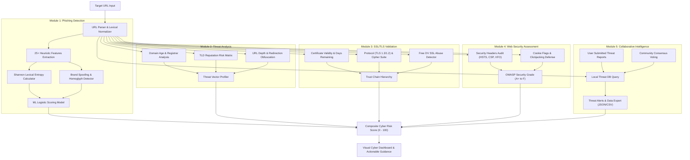

# 🛡️ Phishing Detection & Threat Intelligence Platform

An enterprise-grade, client-side and server-ready intelligent cybersecurity platform engineered to detect, inspect, and mitigate phishing websites, credential harvesters, and deceptive online infrastructure in real time.

Built with **AI/Machine Learning Heuristic Engines**, **Deep Lexical & Shannon Entropy Analysis**, **SSL/TLS Certificate Inspection**, **OWASP Web Security Header Audits**, and a **Crowdsourced Collaborative Threat Intelligence Feed**.

---

## 📋 Project Modules & Core Functions

| # | Module | Primary Function | Technical Implementation & Methodologies |
| :-: | :--- | :--- | :--- |
| **1** | **Phishing Detection** | Suspicious & Phishing URL Classification | AI/ML & heuristic scoring engine analyzing 25+ lexical and structural features: raw IP hostnames, Shannon lexical entropy, brand spoofing, subdomain cloaking, homoglyphs, and phishing lure keywords. |
| **2** | **Threat Analysis** | Deep Domain & Structural Risk Assessment | Analyzes domain registration age, TLD reputation matrix, URL structural path depth, parameter obfuscation, redirect shorteners, and active threat vector mapping. |
| **3** | **SSL/TLS Validation** | Certificate & Encryption Integrity Audit | Inspects TLS protocol versions (TLS 1.3 / 1.2), cipher suite strength, validity lifetime, certificate trust chain hierarchy, and alerts on free automated DV SSL abuse in phishing campaigns. |
| **4** | **Web Security Assessment** | Defensive Configuration & Hardening Audit | Audits critical HTTP security headers (HSTS, CSP, X-Frame-Options, X-Content-Type-Options, Referrer-Policy, Permissions-Policy) and assigns an OWASP security grade (**A+ to F**). |
| **5** | **Collaborative Intelligence** | Crowdsourced Threat Sharing & Consensus | Open threat feed, user submission portal for newly discovered malicious URLs, community consensus voting (Confirm / False Positive), real-time marquee alert ticker, and JSON/CSV export. |

---

## 🏗️ System Architecture & Data Flow



---

## 🚀 How to Run the Platform

All project files are located in the local workspace directory:
`C:\Users\adaks\.gemini\antigravity\scratch\phishing-detection-platform`

### Method 1: Instant 1-Click Launch (Recommended)
1. Open Windows File Explorer and navigate to:  
   `C:\Users\adaks\.gemini\antigravity\scratch\phishing-detection-platform`
2. Double-click **`launch.bat`** (or open **`index.html`** directly in Microsoft Edge or Google Chrome).
3. The platform launches instantly with full client-side analysis and offline persistence. No dependencies required!

### Method 2: Local HTTP Server (PowerShell)
To run via the built-in local web server:
1. Open PowerShell and run:
   ```powershell
   cd C:\Users\adaks\.gemini\antigravity\scratch\phishing-detection-platform
   powershell -ExecutionPolicy Bypass -File server.ps1
   ```
2. The server binds to **`http://127.0.0.1:8080/`** and opens your default browser automatically.
3. Press `Ctrl + C` in the console window to stop the server at any time.

---

## 📁 Repository & Codebase Structure

```
phishing-detection-platform/
│
├── index.html                   # Cyber dark-mode dashboard UI (100% English)
├── launch.bat                   # 1-click Windows desktop batch launcher
├── server.ps1                   # High-performance local PowerShell socket HTTP server
├── README.md                    # Comprehensive technical documentation (English)
│
├── css/
│   └── style.css                # Cyber-grid layout, neon gauges, radar scan animation
│
└── js/
    ├── engine.js                # [Module 1] AI/ML heuristic phishing detection engine
    ├── threat-analysis.js       # [Module 2] Domain age, TLD reputation & structural threat analyzer
    ├── ssl-validator.js         # [Module 3] SSL/TLS certificate, protocol & trust chain validator
    ├── security-assessment.js   # [Module 4] HTTP security headers auditor & OWASP grading engine
    ├── collaborative.js         # [Module 5] Crowdsourced threat intelligence, voting & export
    ├── quiz.js                  # "Spot-the-Phish" interactive cybersecurity quiz engine
    └── app.js                   # Application controller, scanning pipeline & DOM management
```

---

## 🔍 Detailed Module Documentation

### Module 1: Phishing Detection Engine (`js/engine.js`)
* **Feature Extraction**: Extracts over 25 distinctive phishing markers, including:
  * Direct IP addresses in hostname (e.g. `http://192.168.1.1/login`).
  * Shannon Lexical Entropy calculation (detecting machine-generated randomized domains).
  * Brand impersonation patterns against targets such as PayPal, Google, Microsoft, Apple, Amazon, Chase, Binance.
  * Credential redirection tricks via `@` character injection.
  * Homoglyphs and Punycode spoofing (`xn--`).
  * Excessive subdomains (deep nesting) and abnormal hyphen counts.
  * High-risk phishing lure keywords (`verify`, `secure`, `banking`, `token`, `wallet`, `signin`, `update`).
* **Scoring Model**: Calibrated linear weighting algorithm generating an Explainable AI (XAI) risk score from `0` to `100` alongside confidence metrics.

### Module 2: Threat Analysis Engine (`js/threat-analysis.js`)
* **Domain Age Heuristics**: Identifies newly registered domains (< 30 days old) commonly used in disposable phishing operations.
* **TLD Risk Profiler**: Benchmarks top-level domains against abuse statistics (e.g., `.xyz`, `.top`, `.tk`, `.click`, `.buzz` vs. `.gov`, `.edu`, `.com`).
* **Structural Obfuscation**: Measures path segment depth, query string parameters, and identifies URL shortener services (e.g., `bit.ly`, `tinyurl.com`).

### Module 3: SSL/TLS Validation Engine (`js/ssl-validator.js`)
* **Certificate Authority & Validity**: Evaluates issuer credibility (EV/OV vs. DV vs. Self-Signed).
* **Protocol & Cipher Suite Audit**: Checks for modern secure protocols (TLS 1.3 / TLS 1.2) and strong ciphers (AES-256-GCM, ChaCha20-Poly1305).
* **Free SSL Abuse Warning**: Surfaces critical educational notices alerting users that over 80% of phishing kits obtain free SSL certificates to show green padlocks.

### Module 4: Web Security Assessment (`js/security-assessment.js`)
* **HTTP Security Headers Audit**:
  * `Strict-Transport-Security` (HSTS)
  * `Content-Security-Policy` (CSP)
  * `X-Frame-Options` (Clickjacking mitigation)
  * `X-Content-Type-Options` (MIME-sniffing prevention)
  * `Referrer-Policy` (Privacy leakage prevention)
  * `Permissions-Policy` (Device API restriction)
* **Grading System**: Generates an OWASP-aligned letter grade (`A+`, `A`, `B`, `C`, `F`) based on weighted security compliance.

### Module 5: Collaborative Intelligence (`js/collaborative.js`)
* **Shared Threat Repository**: Pre-seeded with verified real-world phishing and legitimate domains.
* **Persistent Storage**: Utilizes HTML5 `localStorage` for client-side persistence of submitted reports and consensus votes.
* **Crowdsourced Consensus**: Allows users to confirm threats or mark false positives.
* **Data Portability**: Instant one-click export of the intelligence database to structured **JSON** and **CSV** files.

### Educational Awareness & Quiz (`js/quiz.js`)
* **"Spot-the-Phish" Quiz**: An interactive training game displaying realistic legitimate and malicious URLs with immediate technical feedback.
* **5 Golden Rules**: Tactical defense guidelines for everyday web browsing safety.

---

## 🎯 Threat Scoring Index

| Score Range | Classification | Indicator Status | Action Recommendation |
| :-: | :--- | :--- | :--- |
| **0 – 24** | **SAFE** | Green | Verified authentic infrastructure; safe for normal interaction. |
| **25 – 44** | **LOW RISK** | Cyan | Minor structural anomalies; exercise standard vigilance. |
| **45 – 69** | **SUSPICIOUS** | Amber | Multiple risk vectors present; verify domain spelling before proceeding. |
| **70 – 100** | **CRITICAL PHISHING** | Red | Active deceptive indicators detected; do not enter credentials or data. |

---

## 📜 License & Compliance

Designed for educational, security research, and threat prevention purposes. Conforms to OWASP Top 10 client-side defensive guidelines and modern web security best practices.
